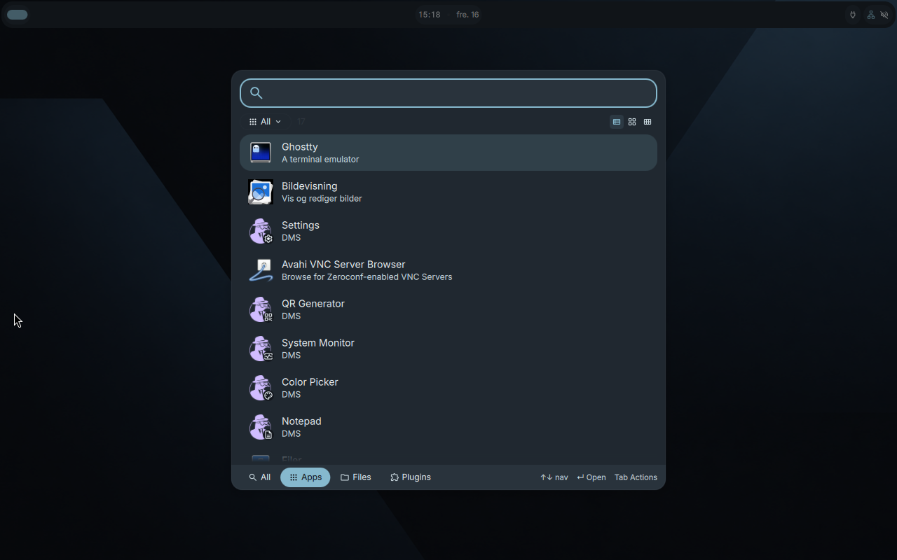
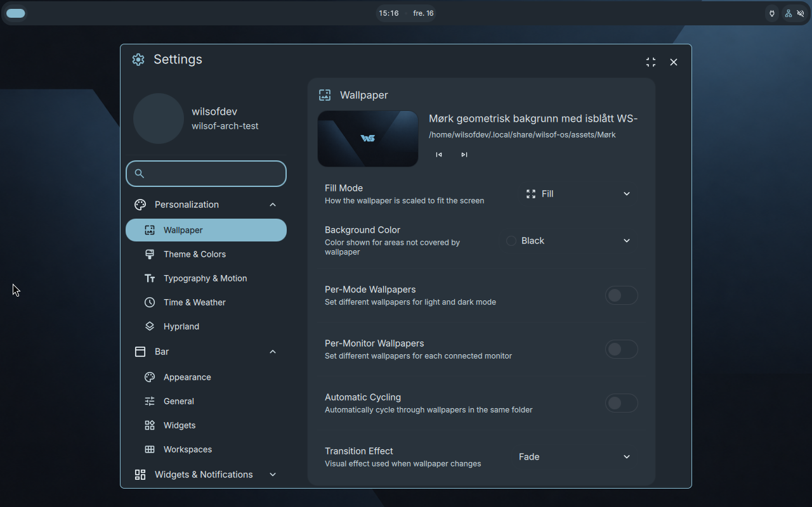
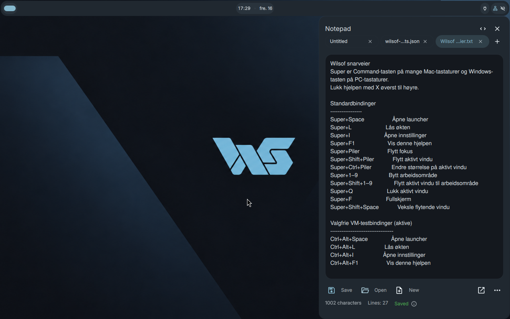
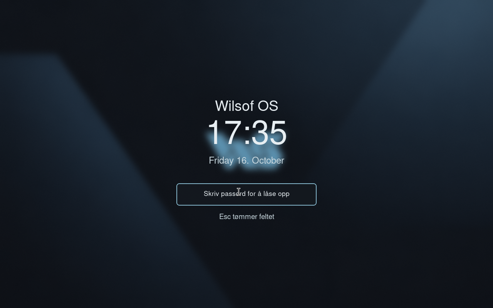

# Wilsof OS

Wilsof OS is an early Arch Linux-based desktop prototype focused on a clean, keyboard-first experience. It combines Hyprland and DankMaterialShell with a consistent visual identity, a unified launcher and a minimal set of everyday applications.

The goal is to make a tiling desktop easy to navigate, with discoverable controls and practical keyboard shortcuts.

Wilsof is under active development. It is not yet a production-ready distribution or a standalone installation image.

## Current prototype

- Arch Linux, greetd/tuigreet, Hyprland and DankMaterialShell (DMS).
- An intentionally empty desktop using the approved WS wallpaper, charcoal `#14181E`, ice-blue `#86B9CE`, thin window borders and restrained rounding.
- A minimal top bar for workspace orientation, time and essential system status.
- `Super+Space` opens the single DMS Spotlight entry. Empty search starts with installed applications; supported local categories expose applications, DMS tools/settings and files when `dsearch` is installed. It is not yet a complete universal search for open windows or every system action.
- `Super+I` opens DMS Settings.
- `Super+F1` opens local shortcut help generated from Wilsof's shared shortcut manifest in DMS Notepad.
- `Super+L` and Hypridle call the same idempotent Hyprlock wrapper. The lock configuration and PAM wiring are present; real password unlock remains a manual check.
- Firefox, Ghostty, Nautilus, GNOME Text Editor, Papers, Loupe and VLC are part of the test-VM package set. Ghostty remains the standard terminal; its actual active-session launch is verified on VM 113.
- `wilsof-doctor` is a read-only development/support check for dependencies, Wilsof-owned files, session units and relevant log locations.
- [`docs/iso.md`](docs/iso.md) describes the internal-only Archiso test-image profile and its safety limits; no ISO is bundled or published.

## Screenshots from the Arch test session

These are screenshots of the running Arch VM, not the browser prototype in `prototype/`.

## What is implemented, and what is not

The application launcher, settings entry, local help renderer, optional VM fallback bindings, theme, wallpaper, active binding layer and installer guards are implemented in the prototype.

The launcher is deliberately application-focused today. Its DMS UI exposes upstream categories, but Wilsof does not claim tested local-file search, open-window search, aliases in Norwegian and English, or system-power actions through that launcher. The physical MacBook → Omarchy → Proxmox keyboard path, Escape/Enter behavior, PAM unlock, idle-lock observation, logout/login and reboot persistence need direct manual verification.

See [the current status](docs/status.md), [test plan](docs/testplan.md) and [known deviations](docs/avvik.md) for evidence and limits.

## Trying the isolated test VM

The repository contains the intended configuration and test-VM scripts; it does not contain credentials, a disk image or an installer release. Use only an authorized disposable Arch VM and follow [the VM runbook](docs/vm-runbook.md). The user-profile installer has an explicit `WILSOF_TARGET_VM=1` guard and only manages Wilsof-owned files in the target user's home directory:

    WILSOF_TARGET_VM=1 /opt/wilsof-os/scripts/install-user-config.sh

The optional VM fallback layer is for clients that intercept Super before it reaches the guest:

    wilsof-vm-test-binds enable
    wilsof-vm-test-binds disable

It adds only `Ctrl+Alt+Space`, `Ctrl+Alt+L`, `Ctrl+Alt+I` and `Ctrl+Alt+F1`; it does not replace the standard Wilsof bindings.

## Everyday use

The English [user guide](docs/brukerveiledning.md) covers opening applications, settings, help, workspaces, locking, power actions and the VM fallback layer. Architecture and design boundaries are documented in [architecture](docs/arkitektur.md) and [decisions](docs/beslutningslogg.md).

## Development checks

Read the concise [engineering guide](CONTRIBUTING.md) before contributing. The [quality audit](docs/quality-audit.md) records the current evidence, fixes and bounded follow-ups.

    python3 -m pip install -r requirements-dev.txt
    python3 -m pytest -q
    shellcheck --exclude=SC1091 --shell=sh bin/wilsof-doctor bin/wilsof-help bin/wilsof-lock bin/wilsof-search bin/wilsof-vm-test-binds scripts/bootstrap-desktop.sh scripts/build-iso.sh scripts/install-user-config.sh scripts/preflight-arch.sh scripts/preflight-fedora.sh
    shellcheck --shell=bash automation/wilsof-github-worker.sh scripts/install-arch-test-vm.sh

    python3 -m json.tool config/dms/wilsof-theme.json

The bounded [GitHub workflow](docs/github-workflow.md) documents the project queue, approval marker, hourly model-free queue check and the reason automatic model starts are disabled.

GitHub Actions runs these local validation checks without secrets, homelab access, deployment or destructive disk operations.

## Branch and maturity

The active Arch work is on `arch-install`. The repository default branch is `main`; its GitHub landing page remains unchanged until pull request review and merge. Review the current work directly at [the Arch branch README](https://github.com/tomli0/wilsof-os/blob/arch-install/README.md) and [pull request #1](https://github.com/tomli0/wilsof-os/pull/1).

Historical Fedora material is retained where useful as history. It is not the active prototype path.

## Credits and license

Wilsof integrates Arch Linux, Hyprland, Hyprlock, Hypridle, DankMaterialShell and the listed desktop applications. Wilsof does not claim ownership of those upstream projects. No license file is currently included in this repository; no license grant should be inferred until one is added.
