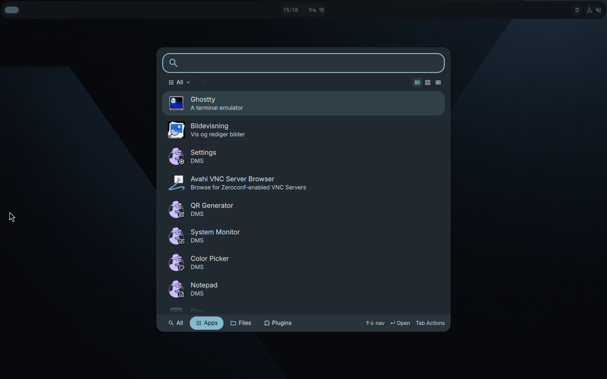
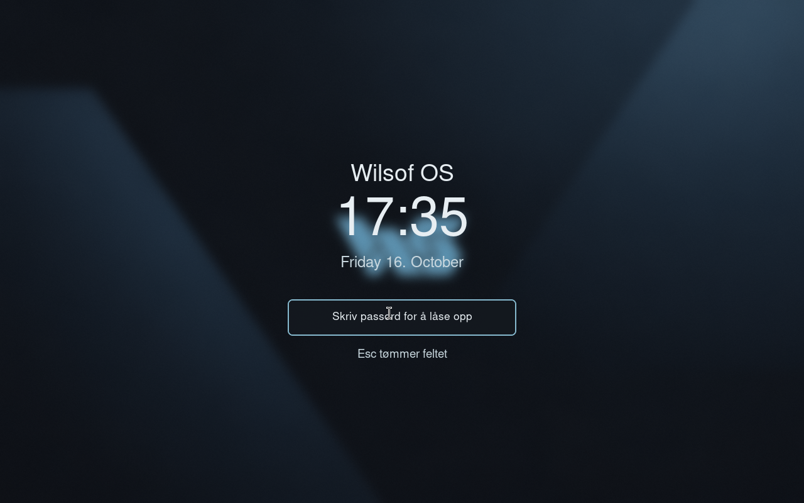

# Wilsof OS

Wilsof OS is an experimental Arch Linux desktop for a keyboard-first daily-driver
experience. It combines Hyprland, Dux/DankMaterialShell and Wilsof-owned menu,
configuration, installer and maintenance tools.

**Not ready to replace Omarchy.** Internal test ISOs exist privately; there is no
accepted public release. Source tests, native package tests, virtual acceptance
and physical hardware acceptance are separate gates.

## Current development

The single authoritative live dashboard is
[project status #16](https://github.com/tomli0/wilsof-os/issues/16).
[Daily Driver acceptance #60](https://github.com/tomli0/wilsof-os/issues/60) tracks
remaining defects and acceptance, with the current delivery in
[draft PR #61](https://github.com/tomli0/wilsof-os/pull/61), branch
`integration/private3-20261107`. This integration stream is an explicit temporary
exception; normal future changes follow the protected-main workflow.

The GitHub default branch is not automatically the latest private candidate.
Nothing here authorizes merging, publishing an ISO or changing owner hardware.
Historical reports remain available in Git and under `docs/development-reports/`;
[the status pointer](docs/status.md) avoids another competing dated dashboard.

## Current source candidate

- One resident Wilsof Menu, eight categories, ranked local application/action
  search, nested navigation and explicit power confirmation.
- Shared shortcut editor and managed configuration with personal-setting
  preservation; actual active-session and physical-client evidence remain scoped.
- Read-only hardware diagnostics and an explicit installer plan with target
  identity, live-media/mount guards and separately confirmed synthetic replacement.
- Source-pinned image payload, dated signed repository policy, native package
  provenance and fail-closed production signing/trust gates.
- Standard Ghostty terminal, approved WS branding and a restrained charcoal and
  ice-blue desktop. Earlier VM screenshots below are historical, not this RC.
- Explicit host artifact inventory/cleanup, protected retention and audited
  end-of-sprint maintenance; never an unattended deletion service.

See [the user guide](docs/brukerveiledning.md),
[installer/build boundaries](docs/iso.md), [security gates](docs/security.md),
[package signing](docs/package-signing.md), [recovery](docs/recovery.md) and
[Omarchy transition requirements](docs/omarchy-transition.md).

## Remaining Daily Driver gates

1. Owner-authenticated production signing identity, protected custody and narrowly
   approved public trust enrollment. No key/signature approval is implied.
2. Native acceptance of the retained production signed packages and real consumers.
3. A coherent future update closure and recovery, not a partial library upgrade.
4. A separately approved new source-pinned ISO after privilege/capacity gates.
5. Complete exact-new-image virtual acceptance, security and notice/license checks.
6. Physical MacBook hardware, backup/restore and replacement acceptance.

Keep Omarchy and owner data intact. The current retained candidate still has a
historical portal teardown defect; a later source correction is not a new ISO.
No physical Wi-Fi, graphics, trackpad, audio, Bluetooth, suspend or power pass is
inferred from emulator evidence.

## Historical screenshots

These captures are from the October 16 VM session, not the current source/ISO.
VM113 and the historical Fedora disk remain protected.

## Development and retention

Read the [engineering guide](CONTRIBUTING.md),
[engineering standard](docs/ENGINEERING_STANDARDS.md),
[quality audit](docs/quality-audit.md) and
[artifact maintenance procedure](docs/artifact-maintenance.md).

    python3 -m pip install -r requirements-dev.txt
    python3 -m pytest -q
    shellcheck --shell=bash automation/wilsof-github-worker.sh scripts/install-arch-test-vm.sh iso/profiledef.sh

GitHub Actions also checks the prescribed shell dialects and JSON inputs.
Maintenance fixture tests use qemu-img, xorriso and squashfs-tools, not a product
ISO build or VM boot. The host-only maintenance CLI defaults to read-only:

    python3 scripts/artifact-maintenance.py --policy /private/run/retention.json

Develop → Test → Deliver → Preserve essential evidence → Clean up → Continue.
Hermes owns that close-out. Use explicit successful-workflow manifests and exact
approved cleanup targets. Preserve unresolved failures, pinned artifacts,
backing chains, source/WIP, credentials and shared dependency stores. Routine
status belongs on existing #16/#60/PR61; do not make report-only branches or
redundant source archives. See the [GitHub workflow](docs/github-workflow.md).

## Credits and redistribution

Wilsof integrates upstream projects; it does not claim their ownership.
Licensing, required notices and proprietary-driver redistribution remain explicit
release gates. No new blanket license grant or public binary redistribution
approval is made by this development README.
