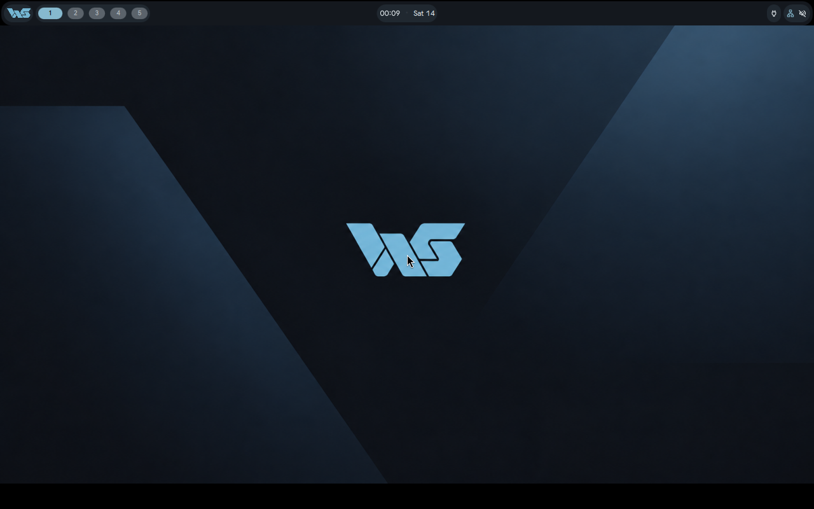
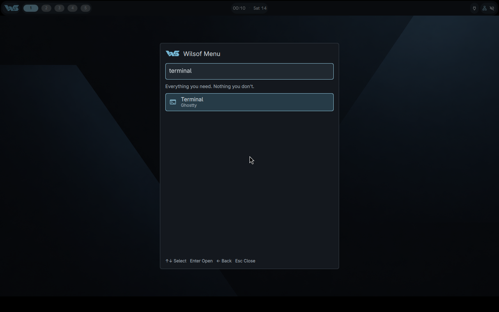
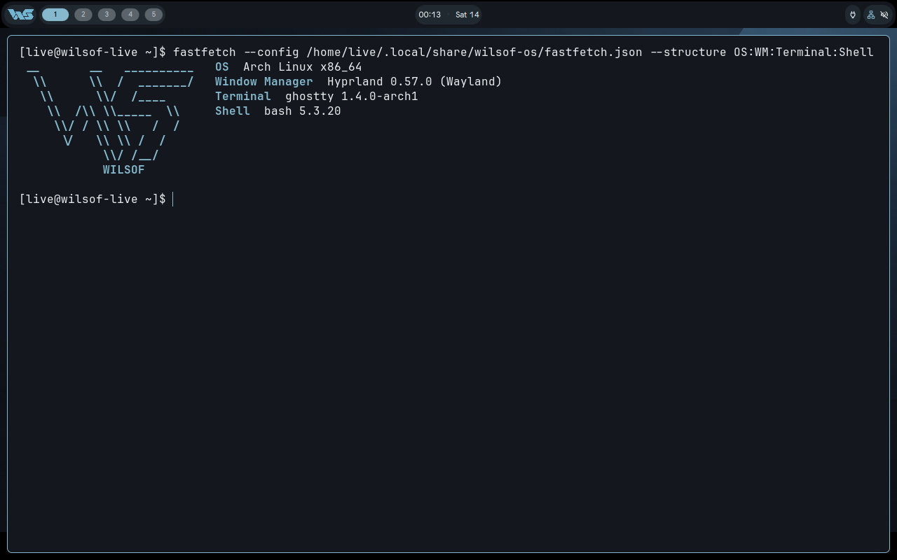
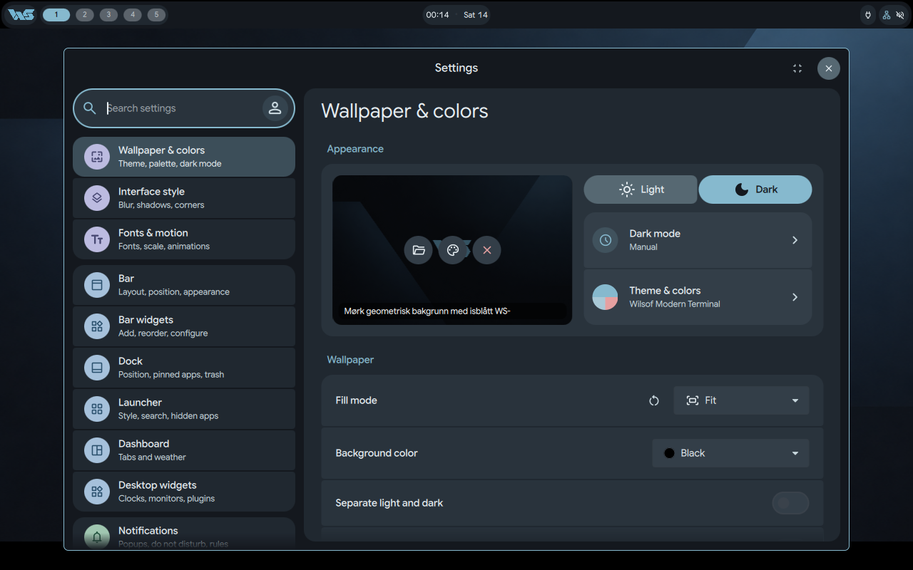

# Wilsof OS


An Arch-based desktop built around your keyboard. Hyprland, a unified Wilsof Menu,
and a restrained charcoal-and-ice-blue workspace.

[Desktop](#the-desktop) · [Installation](#try-wilsof) ·
[Status](#project-status) · [Documentation](#documentation)

> **TEST ONLY — not production-ready.** RC4 passed 66/66 virtual acceptance checks.
> Physical hardware acceptance and production approval are still pending.
> Do not replace your existing system or use Wilsof for production workloads.

## The desktop



### A focused foundation

- **Keyboard-first workflow.** Hyprland workspaces, shared shortcuts, and fast
  navigation through a single Wilsof Menu.
- **One place to start.** Local application and action search, nested categories,
  appearance controls, and explicit confirmation for power actions.
- **Familiar applications.** Ghostty, Firefox, and Files in a consistent dark
  environment.
- **Deliberate installation and maintenance.** Mandatory LUKS2-encrypted root,
  explicit target confirmation, and signed-snapshot update checks that refuse
  incomplete or inconsistent proposals.

### Launcher

Search applications and actions without leaving the keyboard.



### Terminal

Ghostty with Wilsof branding. The capture shows real, software-only Fastfetch output.



### Settings

Wallpaper, colors, and visual preferences in the native settings interface.



All four images are authentic 1280 × 800 captures from the exact RC4 image in a
separate, diskless Live session—not mockups. They are losslessly optimized;
[image provenance](docs/assets/readme/README.md) records the source and scope.

## Try Wilsof

Start with a disposable **x86_64 UEFI virtual machine**, not your everyday computer.
There is no public ISO release or production installation path yet.

The [getting-started guide](docs/getting-started.md) covers the accepted image
identity, checksum verification, Live mode, keyboard shortcuts, and the boundaries
for installation on a blank virtual disk. The installer encrypts the root
filesystem with LUKS2; the EFI System Partition remains unencrypted.

Keep your current OS and data intact. Physical installation requires separate
hardware, backup/restore, trust, and owner-approval gates.

## Project status

**RC4: virtually accepted, TEST ONLY.** The exact candidate passed **66 checks,
with 0 failures and 0 unrun checks**, including encrypted installation, cold boot,
session locking, update interruption, and recovery scenarios.

That result is not a hardware certification, a security certification, or a promise
of reliable future updates. Physical compatibility, restorable backups,
production signing/trust, and ongoing security-update responsibility remain
release gates—not completed features.

Follow [project status #16](https://github.com/tomli0/wilsof-os/issues/16) for the
current decision and remaining work. This presentation does not publish an ISO,
merge the integration branch, or change the accepted image.

## Documentation

- [Getting started](docs/getting-started.md) — image identity, Live evaluation,
  installation boundaries, and essential shortcuts.
- [Update and recovery design](docs/update-transition.md) — signed snapshot
  transitions, fail-closed checks, and explicit repair.
- Development workflow: [engineering guide](CONTRIBUTING.md) and
  [quality audit](docs/quality-audit.md) (historical findings).
- [Engineering standards](docs/ENGINEERING_STANDARDS.md) — project quality rules.

Developer check for the Bash ISO profile:

```sh
shellcheck --shell=bash iso/profiledef.sh
```

Wilsof builds on Arch Linux, Hyprland, Dux/DankMaterialShell, Ghostty, and other
upstream projects. Their licenses and notices remain applicable; binary
redistribution and production-release approval are separate gates.
