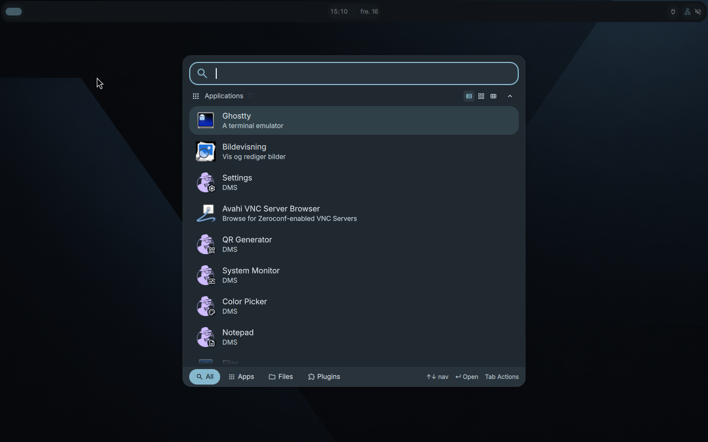

# Wilsof OS

**An Arch Linux-based desktop project built around Hyprland and the Wilsof visual identity.**

Wilsof OS aims to make a keyboard-first tiling desktop approachable, combining a focused application launcher, discoverable shortcuts, practical desktop tools and a guarded graphical-system installation workflow. This is an **early internal test distribution**, not a production release.

> **Development status (27 October 2026):** An internal Archiso USB image exists, and the candidate 2 system has successfully booted, installed and run in a disposable UEFI/QEMU test environment. Known bugs and physical hardware validation remain. **Do not install it on a disk containing important data.**

## Preview

These are **real screenshots from the earlier Arch development VM (VM 113, 16 October 2026)**. They demonstrate the intended look and interaction, **not screenshots of the final candidate 2 ISO**. The desktop shell and locking implementation continue to evolve.



| Application launcher | Settings |
| --- | --- |
|  |  |
| Shortcut help | Lock screen |
|  |  |

[More development screenshots](evidence/) · [Current project status](docs/status.md)

## What Wilsof includes

- **Arch Linux and Hyprland**, with a branded dark desktop, charcoal `#14181E`, ice blue `#86B9CE`, restrained borders and rounding.
- **Desktop shell:** originally based on DankMaterialShell (DMS). Upstream full-package updates have introduced **Dux 2.0**; compatibility and migration are being stabilized in [issue #30](https://github.com/tomli0/wilsof-os/issues/30).
- **Keyboard-first workflow:** application launcher (`Super+Space`), settings (`Super+I`), shortcut help (`Super+F1`) and lock screen (`Super+L`).
- **Everyday tools:** Ghostty terminal, Firefox and common file/document/media applications in the test configuration.
- **Installer:** an internal Archiso-based image with a guarded interactive installation process, explicit disk selection and confirmation, and a separate installed-user login.
- **Maintenance:** local configuration updates with settings preservation and backups, distinct from Arch's full system package update; diagnostic support via `wilsof-doctor`.

## Verified so far

According to the **candidate 2 test reports from 27 October 2026**, the following were verified in virtual machines:

| Test | Result |
| --- | --- |
| UEFI live USB image boot / RAM-copy mode | Passed in QEMU |
| Install onto a dedicated disposable virtual disk | Passed |
| Boot installed system **without the ISO** | Passed |
| Normal password login, desktop, launcher, settings and help | Passed |
| Ghostty, GTK rendering and Firefox local test page | Passed |
| Manual and five-minute idle lock, wrong-password rejection and successful unlock | Passed in the reported test session |
| Configuration preservation, backup and manual recovery | Passed in the reported test session |
| Offline qcow2 image check after controlled guest shutdown | Returned exit code 0 |
| Automated source tests and CI | 27 focused tests and CI passed for source commit `2739e4a` |

**Important limits:** These results do not establish compatibility with physical PCs. Two crashes and slow software-emulated locking are tracked in [issue #31](https://github.com/tomli0/wilsof-os/issues/31). A Hypridle upstream patch still needs the planned validation. The source-side shell migration fix is **not included in the existing candidate 2 ISO**. Passing source tests does not mean a new image has been built or validated.

## ISO and installation status

The most recently reported internal image is:

- **Image:** `wilsof-internal-2026.10.26-stabilize2-x86_64.iso`
- **Source revision:** `e2561399e5ac5add3711549f9c48e1bcab1486d1`
- **Size:** 2,539,565,056 bytes
- **SHA-256:** `6c909c5f9e78c0326e999fc3977f66164157df19d320a86c6f136ae3f72aeebd`
- **Availability:** private internal development artifact; **not published as a GitHub release or committed to this repository**.

For safe evaluation, see the [internal test runbook](docs/internal-test-runbook.md), [ISO documentation](docs/iso.md) and [physical test checklist](docs/physical-test-checklist.md). Begin with a **live USB session**, without selecting an installation target. Never assume a particular disk device name; identify the USB and internal disks again before writing or installing.

The first physical boot attempt on an Intel Mac reached the live console but failed to start the desktop. This is historical first-image evidence, **not a completed physical test of candidate 2**. The HP and Acer reserve laptops remain untested.

## Roadmap to the next internal image

1. Complete bounded Hypridle and lock stability validation ([#31](https://github.com/tomli0/wilsof-os/issues/31)).
2. Include and validate the DMS-to-Dux migration handling ([#30](https://github.com/tomli0/wilsof-os/issues/30)) in the next **actual** ISO.
3. Build one versioned candidate, then test that exact image in a clean VM.
4. Perform controlled, non-destructive physical live-USB testing before considering installation on a spare machine.
5. Review and integrate via pull requests; no merge or public release is implied by this README.

Track implementation in [draft integration PR #27](https://github.com/tomli0/wilsof-os/pull/27), [project dashboard #16](https://github.com/tomli0/wilsof-os/issues/16) and the [GitHub project board](https://github.com/users/tomli0/projects/1). The default `main` branch may lag the isolated integration work.

## Development

Development and test operations are documented in [CONTRIBUTING.md](CONTRIBUTING.md), [the VM runbook](docs/vm-runbook.md), [architecture](docs/arkitektur.md) and [quality audit](docs/quality-audit.md). The repo does **not** include passwords, private tokens, host secrets or ISO binaries.

Typical checks (from a properly provisioned development environment):

```bash
python3 -m pip install -r requirements-dev.txt
python3 -m pytest -q
python3 -m json.tool config/dms/wilsof-theme.json
```

Review the repository's CI workflow and contribution guide for the exact ShellCheck command and applicable test suite.

## Upstream projects and licensing

Wilsof builds on independent upstream projects including [Arch Linux](https://archlinux.org/), [Hyprland](https://hypr.land/), Hyprlock, Hypridle, and the DMS/Dux desktop-shell ecosystem. The Wilsof project does not claim ownership of those components. **No repository-level license file is currently included; do not infer a grant of rights.**
